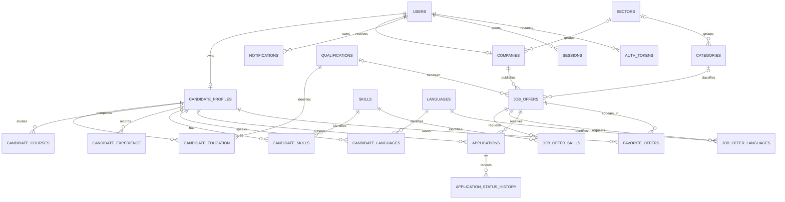

# Database design

The starter follows sections 3–9 of the project PDF, including its candidate and offer forms. Names are in English to match the suggested tables. All tables start empty, including catalogs.

## Tables

| Table | Purpose |
| --- | --- |
| `users` | Name/contact email, password hash, candidate/company/admin role, account state, UI locale, email verification and login timestamps. |
| `candidate_profiles` | One profile per candidate account: phone/city/mobility, summary/current studies, work preferences/availability, professional links, current CV metadata. |
| `companies` | One company per company account: name/CIF, description, website/contact details, address/city, sector, logo, moderation state. |
| `sectors` | Administrable company sectors, reusable by offer categories. |
| `categories` | Administrable offer categories, optionally grouped under a sector. |
| `qualifications` | Searchable qualifications/cycles with codes such as `DAW`. |
| `candidate_education` | Qualification, specialization, institution, years and completion state. |
| `candidate_courses` | Other courses, provider, duration in hours, year and certificate reference. |
| `candidate_experience` | Employer name, position, responsibilities and start/end dates. A null end date means ongoing employment. |
| `languages` | Searchable language catalog with language codes. |
| `candidate_languages` | Candidate language proficiency; one row per candidate/language. |
| `skills` | Searchable skills/tools and their optional category. |
| `candidate_skills` | Candidate skill level and experience in years; one row per candidate/skill. |
| `job_offers` | Company/category, job/internship/collaboration type, description and requirements, minimum qualification/experience, contract/schedule/duration, salary, location/modality, start/publication/expiration and offer state. |
| `job_offer_skills` | Skill, minimum level/experience and whether it is mandatory for the offer. |
| `job_offer_languages` | Language, minimum proficiency and whether it is mandatory for the offer. |
| `applications` | Candidate/offer pair, immutable-by-convention CV snapshot path, cover message, state, actor and withdrawal time. |
| `application_status_history` | Automatically recorded initial application state and later state changes, with actor and timestamp. |
| `favorite_offers` | Saved offers; one row per candidate/offer. |
| `notifications` | Recipient, notification type, translatable structured JSON payload, optional offer/application links and read time. |
| `sessions` | Authenticated session token hash, user, last activity, expiry and optional IP/user agent. |
| `auth_tokens` | Password-reset/email-verification token hashes, expiry and consumption time; one current token per user/purpose. |

## Main relationships

## States and values

| Field | Allowed values | Default |
| --- | --- | --- |
| User role | `candidate`, `company`, `admin` | `candidate` |
| User status | `pending`, `active`, `blocked` | `active` |
| Company status | `pending`, `approved`, `blocked` | `pending` |
| Offer status | `draft`, `pending`, `published`, `closed`, `rejected` | `draft` |
| Application status | `pending`, `reviewed`, `interview`, `accepted`, `rejected`, `withdrawn` | `pending` |
| Education status | `in_progress`, `completed`, `paused` | `in_progress` |
| Offer type | `job`, `internship`, `collaboration` | `job` |
| Modality | `onsite`, `hybrid`, `remote` | Offer: `onsite`; preference: unset |
| Schedule | `full_time`, `part_time`, `flexible` | Offer: `full_time`; preference: unset |
| Contract type | `permanent`, `temporary`, `internship`, `freelance`, `training`, `other` | Required, no default |
| Language level | `A1`, `A2`, `B1`, `B2`, `C1`, `C2`, `native` | Required, no default |
| Skill level | Integer `1`–`5` | Optional |
| Salary period | `hour`, `month`, `year` | `year` |
| UI locale | `ca`, `es`, `en` | `ca` |

Skill levels mean beginner, basic, intermediate, advanced, expert. Use the same scale for candidates and offers. Language levels must be ranked explicitly when matching; alphabetical comparison does not correctly rank `native`.

Salary values are optional decimal amounts per stated period; currency defaults to `EUR`. A single known salary can use equal minimum/maximum values. `immediate_start = true` requires a null scheduled start date. Publication requires `published_at`; application withdrawal requires `withdrawn_at` in the same update.

## Data rules

- IDs use generated `bigint` identities; association tables use composite primary keys. Foreign keys use the same type as their targets.
- Store login emails trimmed and lowercase. Emails, company CIFs, catalog identifiers, and candidate/offer pairs have uniqueness constraints. CIFs are uppercase and trimmed when supplied; database validation does not assert tax-number validity.
- `candidate_id` always references `candidate_profiles.id`, rather than `users.id`.
- Profiles and companies have `user_role` discriminator columns with fixed defaults/checks and composite foreign keys to `users (id, role)`. This prevents a company account from receiving a candidate profile and vice versa. Administrators use their account without a separate profile table.
- Account registration should create the user and its matching profile/company in one transaction. The database allows an account without a completed profile while onboarding.
- `created_at`/`updated_at` default to the transaction timestamp. Update triggers maintain `updated_at` on tables that have it. Timestamps use `timestamptz`; the Docker timezone is UTC.
- Status history is written automatically when an application is created or its status changes. Set `status_changed_by` to the acting account with each change; omitting it leaves the existing actor. Updating other fields does not create a history row. Valid transition sequences remain a backend decision.
- Deleting a user cascades through their profile/company, dependent offers/applications and owned data. Deleting an offer removes its applications/favorites. Actor references and notification links are nulled when their target is removed. Qualification/skill/language catalog entries in use are protected; deactivate them instead of deleting them. Deleting a category/sector clears its optional links.
- The history-to-application foreign key is deferred so overlapping account deletion cascades can finish before referential validation.
- Filter and join columns have indexes. Offer title/description/responsibilities use a GIN text-search index with the language-neutral `simple` configuration. Company, category, location, contract, modality, offer type and publication/expiry filters can be combined by backend queries.

## CVs and authentication

`candidate_profiles.cv_path` points to the current private file. On submission, the backend copies that file to a separate private snapshot and stores its path in `applications.cv_snapshot_path`. Replacing a profile CV does not change that path. The database stores references and optional file metadata; it does not copy, scan, authorize access to, or delete physical files.

`users.password_hash` stores an application-generated password hash, never a plaintext password. Session/reset/verification tokens store 64-character lowercase SHA-256 hashes of cryptographically random tokens. The backend must validate expiry, consumed state, account status, and email verification; revoke sessions after sensitive changes; and replace a user's previous token for the same purpose.

## Backend work still needed

Authorize account ownership and candidate/company/admin permissions in the backend. In particular, only the offer's company should see its applicants/CV snapshots. The database discriminator checks enforce profile type, not request-level permissions.

Publishing should check company approval and account state. Submitting an application should check the offer is published, not expired, and accepts applications; generate the CV snapshot; and insert the application atomically. The unique constraint handles concurrent duplicate submissions. Withdrawal retains the application and its unique pair; resubmission should update that existing row only if the chosen policy permits it.

Offer expiry does not need a new stored status: filter `published` offers by `expires_at IS NULL OR expires_at > CURRENT_TIMESTAMP`. A later scheduled task can close expired offers. Notifications, mail delivery, private file validation, cleanup, translations, and candidate/offer matching are future backend work.

UI translations belong in frontend/backend resources; `preferred_locale` persists the user's choice. The schema has no automatic translation of company-written content. Dashboard totals and reports can be calculated from existing tables. Incident workflows, configurable application settings, queues, and a framework's own migration/session tables can be added when those choices are made.
